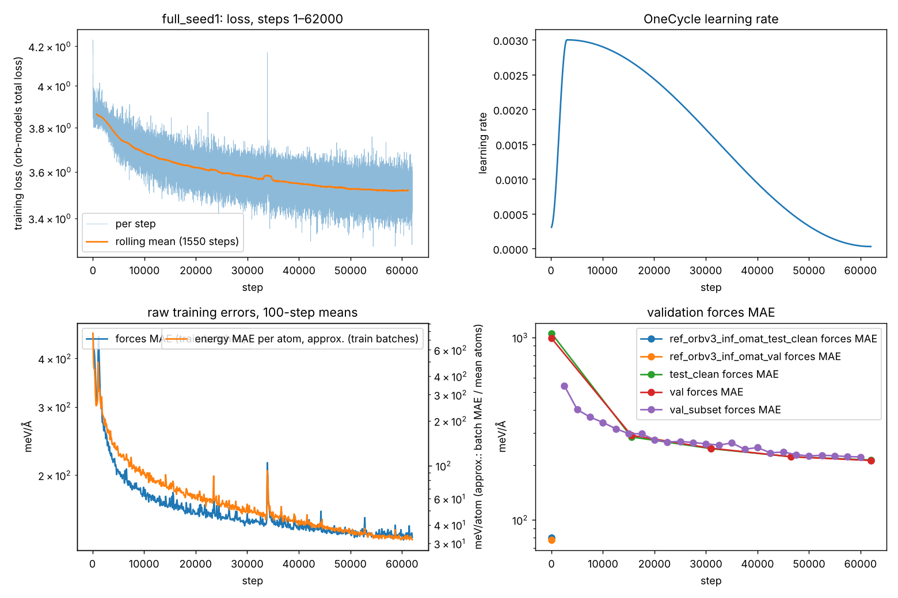
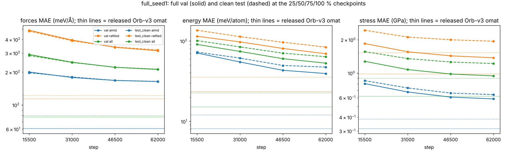

# Retraining Orb-v3 from scratch on Modal

This repository trains copies of the Orb-v3 machine-learned force field from random weights on [Modal](https://modal.com) GPUs, with a spend ledger that refuses any job that would break a dollar cap.

It is the training pipeline of a research project on what universal force fields learn inside. Training copies from scratch lets controlled changes to the training data be tested against the released model. The analysis code, the data lists and the results of probing the copies are not here; they will be released with the paper.

> **What this repository is.** This is a demonstration of the training workflow: how the copies are built, launched, costed and checked. The two runs below show that the pipeline works end to end. They are not the project's findings and are not representative of them. The research results, what these models learn inside and the experiments built on that, are being written up for publication and are deliberately not released here.

## What it has run

In November 2026 it trained two full-data copies (seeds 0 and 1) on the 551,578 AIMD frames of the public OMat24 1M subset:

| Setting | Value |
| --- | --- |
| Architecture | Orb-v3 conservative (`orb_v3_conservative_architecture`, latent 256, MLP 1024, radius 6.0 Å, 120 neighbours), random start |
| Recipe | orb-models 0.5.5 `finetune.py` recipe: Adam, OneCycle learning rate, batch 100, random rotations |
| Length | 62,000 steps (about 11 passes over the frames) |
| Hardware | one H100 80 GB, 8 CPU cores, 32 GiB memory |
| Time and cost | about 4.4 h and $20-25 per copy |
| Checkpoints | state dicts at 0, 25, 50, 75 and 100% of training, each followed by a full validation and clean-test evaluation |

### Pipeline check: the two runs

Mean absolute errors at the end of training (step 62,000), against the released `orb-v3-conservative-inf-omat` evaluated by `modal_app/ref_eval.py` on the same rows. "AIMD" rows are the molecular-dynamics frames; "all" adds the rattled frames. The clean test set drops the 34 starting crystals shared with training.

| Set | Rows | Energy (meV/atom): seed 0 / seed 1 / released | Forces (meV/Å): seed 0 / seed 1 / released |
| --- | --- | --- | --- |
| Validation, AIMD | 58,845 | 39.1 / 39.4 / 8.1 | 164.2 / 164.1 / 60.8 |
| Validation, all | 107,732 | 54.6 / 53.0 / 15.1 | 211.0 / 211.6 / 77.6 |
| Clean test, AIMD | 29,678 | 46.4 / 47.4 / 12.0 | 165.3 / 164.5 / 60.6 |
| Clean test, all | 53,687 | 65.2 / 63.7 / 22.6 | 212.5 / 212.9 / 79.8 |

The copies trained on about 1% of the frames the released model saw in its final stage (551,578 of 55.4 million AIMD frames) and skip its pretraining stage, so they are about 2.7 times worse on forces. That is expected; the copies exist to compare training sets against each other under one recipe, and the two seeds agree closely. Errors were still falling at the end of both runs.

Seed 1 ran in one go, with no pre-emption, out-of-memory skip or NaN, at 408 structures per second, and cost $20.30. Seed 0 was pre-empted once and resumed from its 25% checkpoint ($24.93 including the lost attempt). The spend ledger booked $47.73 in all: the two runs plus the reference evaluation and small test jobs.

Per-checkpoint metrics, training curves and seed 1's run record (code hashes and checkpoint sha256s) are in [`runs/`](runs/):




## What is here

| Path | What it does |
| --- | --- |
| `modal_app/common.py` | Prices and the spend ledger. Every GPU attempt reserves its worst-case cost on a Modal Volume before it starts, sends heartbeats, and books its real cost when it ends. An attempt is refused if the cap (`GLOBAL_CAP_USD`), a phase cap or the end date would be passed. |
| `modal_app/prep_app.py`, `data_jobs.py` | Data jobs on CPU: download the OMat24 1M subset from Meta's public URL, check its sha256, unpack it, extract per-row metadata. Also the image test and the GPU timing runs. |
| `modal_app/train_app.py`, `train_job.py` | The deployed training app. Each chunk trains for up to 6 h, saves its state, and spawns the next chunk, so pre-emptions resume from the last checkpoint. |
| `modal_app/dataset_lmdb.py` | An LMDB dataset that mirrors orb-models 0.5.5 `ase_sqlite_dataset.py`. |
| `modal_app/ref_eval.py` | Evaluates the released `orb-v3-conservative-inf-omat` on the same validation and test rows, as the yardstick. |
| `modal_app/plan_constants.py` | GPU type, cores, memory, chunk length, restarts and pinned package versions. |
| `launch/` | Start, resume and check runs (`launch.py`), a smoke test (`smoke.sh`), the row lists (`make_lists.py`), the ledger table and training-curve plots. |
| `removal/test_overlap_parent_ids.txt` | The 34 starting crystals that appear in both the training and the test split; their rows are dropped from the clean test set. |
| `plan/`, `timing/` | The ledger simulator, run sizing, and measured throughput and memory on H100, A100 40 GB and L40S. |
| `runs/` | Per-checkpoint validation and test metrics for both copies (with the released model's rows), training curves, and seed 1's run record. |
| `tests/test_ledger.py` | Unit tests of the ledger; they need no Modal account. |

## How to run it

1. Install `modal` and log in with `modal setup`. Create two Volumes named `orb-retrain` and `orb-retrain-ledger`; the code opens them as version-2 Volumes.
2. Prepare the data, from `modal_app/`:
   ```
   python run_fn.py data_download download.json
   python run_fn.py data_metadata metadata.json
   ```
3. Build the row lists, from the repository root:
   ```
   modal volume get orb-retrain meta data/
   python launch/make_lists.py
   modal volume put -f orb-retrain lists lists
   ```
4. Deploy the training app: `cd modal_app && modal deploy train_app.py`.
5. Run the smoke test (`launch/smoke.sh`), then start a copy: `./launch_run.sh full <seed>`. Check it with `python launch/launch.py status <run_id>`.

Before any spend, set `GLOBAL_CAP_USD` in `modal_app/common.py` and `END_DATE_UTC` in `modal_app/plan_constants.py` to your own limits. Some docstrings still give paths relative to a parent `retrain/` folder and refer to an internal plan document that is not included.

## Tests

The ledger tests run without Modal:

```
cd tests && python -m pytest test_ledger.py
```

## Credits and licence

- Model code and training recipe: [orb-models](https://github.com/orbital-materials/orb-models) by Orbital Materials, Apache License 2.0. `modal_app/dataset_lmdb.py` follows its `ase_sqlite_dataset.py`.
- Data: [OMat24](https://huggingface.co/datasets/facebook/OMAT24) by Meta FAIR, CC BY 4.0. It is downloaded at run time and is not in this repository.
- This repository is released under the Apache License 2.0 (see `LICENSE` and `NOTICE`).
